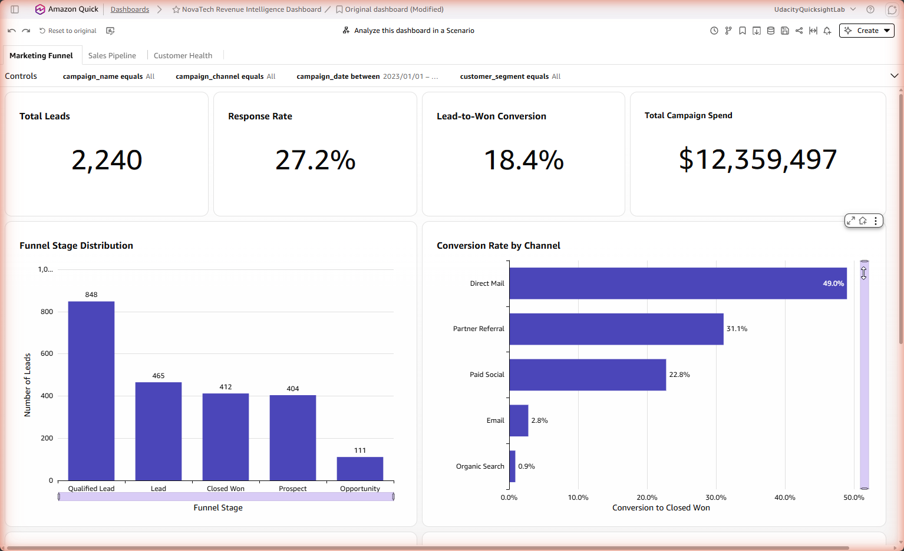
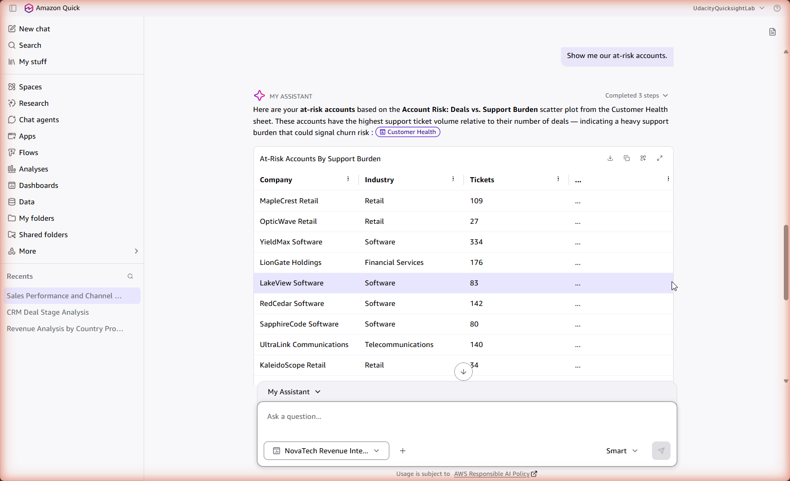
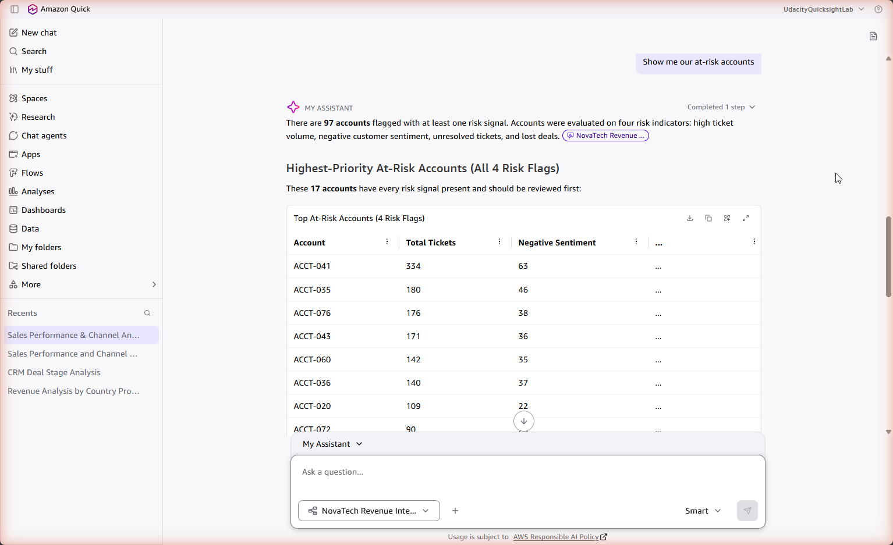

# Revenue Intelligence Dashboard — NovaTech Solutions

A three-source BI build in Amazon Quick Suite: 499 closed deals, 2,240 marketing leads and 3,000 support
tickets unified into one dataset, three interactive dashboard sheets, and a natural-language layer whose
failures are documented rather than hidden.

Built for a fictional VP of Revenue named Sarah Chen. Prompted by Udacity's *Future AWS Agentic AI Business
Professional* programme; passed on the second submission, 13 September 2026.

## What this project is actually about

The dashboard is the assignment. The interesting part is the second half: what happens when you point a
natural-language query engine at a joined dataset and it starts producing answers that look like analysis.

Every AI answer in this repo was checked against something — a named visual, or the source CSV when no
visual existed. That checking produced a taxonomy of five failure modes, ordered by how hard each is for a
reader to catch:

| # | Failure mode | Example from this project | Caught by |
|---|---|---|---|
| 1 | Wrong denominator | Average deal value $1,417 (all 499 deals) instead of $2,245 (315 won) | Anyone who knows the data |
| 2 | Fan-out inflation | Revenue summed on the joined table comes back 143× too high | The absurdity of the number |
| 3 | Invented definition | "At-risk accounts" answered on a single criterion: 3 of 10 accounts correct, 40% of at-risk revenue missed | Knowing the right answer |
| 4 | Correct conclusion on fabricated evidence | Channel table showing 700 leads where the data holds 2,240 — while the percentages derived from those counts were right to two decimals | Independent ground truth only |
| 5 | Correct figures, inverted conclusion | A 2.8-hour spread across four severity levels read as proof that priority "is getting prioritised appropriately" | Someone who already understands what the result means |

Modes 4 and 5 are the argument. They look exactly like good analysis — a conclusion, a table of workings, a
confident sentence — and neither can be caught by plausibility.

## The contradiction worth reading

The same product, on the same data, reached opposite conclusions about the sales cycle depending on how it was
asked.

- **Auto-generated executive summary**, unsolicited: sales cycle "surged to 90.1 days in Q1 2025, a 65.78%
  increase… signaling growing delays." The arithmetic is exact. Q1 2025 holds **28** closed deals against 96
  in the previous quarter, because the dataset ends 31 January 2025.
- **Quick Chat**, asked directly: the cycle is **shortening**, grouped by deal-creation cohort — and it
  volunteered that recent cohorts look artificially fast because only quick-closing deals have had time to
  close, then restricted its own conclusion to the complete-data window.

The unsolicited version was wrong and came with no caveat. The version that required asking was right and
caveated itself. Anyone who reads only the generated summary never sees the correction.

## What the data said

Five findings, each with the action attached in the dashboard annotations:

1. **Spend concentrates in the channels that convert worst.** Direct Mail converts 49.0% of leads at $9,881
   per win; Organic Search converts 0.9% at $256,709 per win while absorbing the second-largest lead volume
   (671 leads, 6 wins).
2. **Severity does not drive triage.** Critical tickets resolve in 56.1 hours, low-priority in 58.9. Critical
   and high tickets also carry the worst sentiment of any level (28.0% and 28.7% negative, against 20.6% for
   low). A routing rule, not headcount, is the cheapest fix in the data.
3. **The largest customers are the largest support burden.** Account revenue and ticket volume correlate at
   r = +0.59. The ten highest-risk accounts hold $182,814 — 25.9% of closed-won revenue. One account files 334
   tickets, 11.1% of all support load, against 5.8% of revenue.
4. **Win rates vary 20.8 points across six managers** (70.8% against 50.0%) on comparable deal sizes. The two
   largest loss reasons, No Decision Made and Poor Product Fit, are 47% of all losses — qualification
   problems, not pricing ones.
5. **Two patterns the data does not support.** Recent ticket volume does not predict deal size ($2,242 against
   $2,272), and Partner Referral's 1.7-point win-rate lift is too small to act on. Both are stated so the team
   does not chase them.

## Data model decisions

- **Anchor table: CRM deals, LEFT join on `account_id`.** Every question in the brief resolves to a deal or a
  customer with a commercial relationship, so the CRM is the table that keeps every record.
- **Fan-out disclosed as a number, not hidden.** One customer has many deals, leads and tickets, so the join
  produces **63,420 rows from 5,739 records**. Summing revenue on it would report $100,900,682 instead of
  $707,201. Every currency total is therefore drawn from the CRM view, and every count uses a distinct
  composite key.
- **Composite keys where the dictionary was wrong.** `opportunity_id` has 496 distinct values across 499 rows
  and `ticket_id` has 2,996 across 3,000 — the data dictionary documents both as unique. `opportunity_id +
  account_id` and `ticket_id + account_id` are unique.
- **Hours, not days, for resolution time.** `ticket_created_date` is a plain date and `ticket_resolved_date`
  carries a timestamp; the mismatch is exactly what made the AI report 1.95 days instead of 58.7 hours. The
  field is typed explicitly with a DateTime mask, and the dashboard's `dateDiff` truncation is disclosed
  separately (58.20 hours on screen against 58.70 at full precision).
- **Fifteen orphan accounts remain visible but excluded from the join.** They exist in marketing and support
  but never in the CRM: 204 tickets and 150 leads. Excluding them is a design decision, not an accident.

## The natural-language layer

Quick Chat was tested twice: scoped to the published dashboard with no configuration, then scoped to a
configured Topic, re-asking the same three questions. One variable changed.

| Question | Before | After |
|---|---|---|
| Win rate | Correct (63.1%), cited the sheet | Correct (63.1%), cited all 499 deals |
| Best-converting channel | Correct percentages | Percentages correct, **supporting table fabricated** |
| At-risk accounts | One invented criterion, 3 of 10 accounts, 40% of revenue missed | Four criteria, every figure exact, zero-revenue accounts set aside |

Topic configuration is not monotonic improvement. It fixed the question that required cross-domain reasoning
and introduced an error on one that did not.

## Repository map

| Path | Contents |
|---|---|
| `docs/01_data_verification_log.md` | Eleven verification questions across the three sources, with two documentation defects proven against the raw CSV |
| `docs/02_q_exploration_log.md` | Before/after Topic comparison and five exploration questions, with four discrepancies written up in full |
| `docs/03_dashboard_annotations.md` | Five dashboard annotations: quantified finding, business implication, recommended action |
| `docs/04_executive_summary_verification.md` | The auto-generated summary reproduced verbatim, then checked claim by claim |
| `docs/05_executive_report_sarah_chen.pdf` | The two-page report written for the VP of Revenue |
| `docs/PROJECT_REVIEW.md` | Post-submission review: what the reviewer said, what I verified independently, known limitations |
| `dashboards/` | Per-sheet PDF exports and the annotated three-sheet export |
| `screenshots/` | 73 screenshots grouped by task, from import through to annotated sheets |

## Known limitations

Stated here rather than left for a reader to find:

- **The verification log's summary tally is off by one.** It says "9 clean passes"; the entries support
  **8** clean, 2 that pass on the count while failing the dictionary, and 1 partial fail. The report repeats a
  third version of the same count. The entries themselves are correct — the summary line is not.
- **The report says "ten questions were put to Quick Chat."** The log holds **8 distinct questions** (three
  baseline, five new); counting every interaction gives 11.
- **Two recommendations are causal claims resting on descriptive comparisons.** "Worth roughly 17 additional
  wins" and "a quarter of the revenue base has no early warning" both describe what a comparison implies, not
  what an intervention was shown to produce.
- **Action semantics were not fully correct.** Region selection also filtered deal stage, and cross-sheet
  account navigation did not visibly carry account context.
- **The dashboard title reads "Novateach"** in the published screenshots — a typo for NovaTech that survived
  into the export.
- **No open pipeline.** The CRM extract contains only closed deals, so the dashboard reports what happened
  rather than what is coming. Forecasting was explicitly out of scope.

## Notes on the artefacts

NovaTech Solutions is a fictional company and the three source CSVs are course material, so only schemas,
counts and derived figures appear here — no source data is redistributed. Screenshots are taken in a shared
course lab account (`UdacityQuicksightLab`) and carry no personal identifiers.

## Programme

Second project in Udacity's *Future AWS Agentic AI Business Professional*: build the dashboard that answers
questions inside a company, then build the agent that answers questions about a market.

- Project 2 — market intelligence agent for Kuala Lumpur short-term rentals:
  [market-intelligence-agent-kuala-lumpur](https://github.com/irfanzulkifle/market-intelligence-agent-kuala-lumpur)

## Licence

Text and documents: MIT. See [LICENSE](LICENSE).
